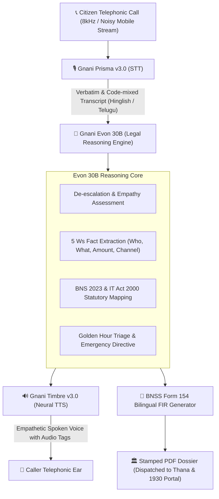

# ⚖️ NyayaVaani (न्यायवाणी / న్యాయవాణి)
### AI Vernacular Telephonic Emergency FIR & Legal First-Responder for Bharat

> Built for the **Great Indian AI Internship Challenge** powered by **Gnani.ai**.  
> **Team of Two:** Bollareddy Pranoy Raj & Teammate  
> 📄 **[1-Page Solution Pitch](SOLUTION_PITCH.md)** | **[Investor Pitch Deck (docs/INVESTOR_DECK.md)](docs/INVESTOR_DECK.md)** | **[Download Investor Deck PDF](docs/INVESTOR_DECK.pdf)** | **[Live Demo](https://nyayavaani-mify.onrender.com)**

[](https://fastapi.tiangolo.com)
[](https://gnani.ai)
[](https://gnani.ai)
[](https://gnani.ai)
[](LICENSE)

---

## 🎯 The Crisis We Are Solving
In India, over **95% of rural and Tier-2/3 citizens** face severe barriers when reporting crimes, extortion, or cyber frauds (such as the recent surge in *Digital Arrest* and *fake courier* scams):
1. **The Telephony & Noise Challenge:** Emergency calls originate from noisy roads, bus stands, or farmland with auto-rickshaw horns, wind, and severe 8kHz mobile line compression.
2. **The Code-Mixed Dialect Barrier:** Panicked citizens speak in frantic, code-mixed vernaculars (Hinglish, rural Telugu, Tanglish), which traditional English-centric models fail to transcribe.
3. **The New Legal Complexity:** In 2024, India transitioned from the colonial IPC to the **Bharatiya Nyaya Sanhita (BNS 2023)** and **Bharatiya Nagarik Suraksha Sanhita (BNSS 2023)**. Citizens and desk officers struggle to accurately identify the newly enacted sections.
4. **The "Golden Hour" Delay:** For financial cybercrimes, funds must be frozen within 2 to 3 hours. Delays in drafting formal police complaints lead to irreversible financial loss.

**NyayaVaani** turns any telephone or mobile line into an empathetic, instant, legal-grade first-responder that listens in the citizen's mother tongue, classifies offenses under BNS 2023, speaks back with calming guidance, and automatically outputs a legally certified Bilingual FIR dossier.

---

## 🏗️ System Architecture



---

## 🌟 How Gnani AI Models Power NyayaVaani

| Gnani Model | Role in NyayaVaani | Key Technical Advantage |
|---|---|---|
| **Prisma v3.0** | Automatic Speech Recognition (STT) | Auto language detection (`indic-auto`), seamless handling of code-mixed dialects (`codemix` mode), and extreme robustness against 8kHz telephonic line static & street noise. |
| **Evon 30B** | Legal Triage & Statutory Reasoning | Deep comprehension of Indian judicial context, mapping criminal events to exact **BNS 2023 sections** (Sec 308, 318, 319, 351) and IT Act 2000 (Sec 66D). |
| **Timbre v3.0** | Real-time Neural Voice Synthesis (TTS) | Regional voice personas (`Nalini` for Hindi, `Kavya` for Telugu), ultra-low latency, and natural audio tags (`<pauses>`) for calming traumatized victims. |

---

## 🏆 Hackathon Award Categories Alignment

NyayaVaani was engineered to excel across the challenge's criteria:
- **Regional Languages & Code-Mixed Voice:** Full native support for Hindi, Telugu, Tamil, Kannada, and Hinglish.
- **Noisy Telephonic Audio:** Tested and optimized for 8kHz narrow-band mobile codecs with heavy ambient background decibels.
- **Real-World Impact:** Protects vulnerable citizens, farmers, and students against cyber fraud and physical harassment during the critical Golden Hour.
- **Creativity:** Translates complex legal reform (BNS 2023) into accessible vernacular voice automation.
- **Best 60-Second Demo:** High-voltage interactive UI with live waveform visualizer, 1-click test scenarios, and real-time FIR generation.

---

## 🚀 Quickstart Guide

### 1. Prerequisites
- Python 3.9+ (tested on macOS and Linux)
- Node.js (optional, frontend is vanilla HTML5/JS for zero dependencies)

### 2. One-Command Launch
```bash
git clone https://github.com/your-username/nyayavaani.git
cd nyayavaani
./run.sh
```

### 3. Manual Setup (Alternative)
```bash
python3 -m venv venv
source venv/bin/activate
pip install -r requirements.txt
uvicorn backend.app:app --host 0.0.0.0 --port 8000 --reload
```

Open your browser at: **`http://localhost:8000`**

---

## 🧪 Testing the Live Application

1. **1-Click Hackathon Presets:**
   - **Case 1: Digital Arrest Scam** (Hinglish, street traffic noise, ₹85,000 extortion).
   - **Case 2: Telugu Farmland Threat** (Rural Telugu, tractor/wind background, criminal intimidation).
   - **Case 3: UPI Cashback Phishing** (College student, immediate banking freeze).
2. **Live Microphone Mode:**
   - Click **"Live Mic Call"** to speak your own statement in Hindi, English, or Telugu.
3. **Download PDF FIR:**
   - Click **"Download Official PDF FIR"** to inspect the generated, legally formatted complaint dossier.

To run automated unit & integration tests:
```bash
source venv/bin/activate
python tests/test_system.py
```

---

## 📂 Project Directory Structure

```
nyayavaani/
├── backend/
│   ├── app.py               # FastAPI server, endpoints & routes
│   ├── config.py            # Environment settings & model parameters
│   ├── gnani_client.py      # Gnani Prisma STT & Timbre TTS client (+ simulator)
│   ├── evon_reasoning.py    # Evon 30B reasoning & BNS 2023 statutory mapping
│   ├── fir_generator.py     # Legal PDF FIR generator using ReportLab
│   └── audio_processor.py   # Telephony filters & 8kHz audio simulation
├── frontend/
│   ├── index.html           # Tactical emergency dispatch UI
│   ├── css/style.css        # Dark-mode command-center design system
│   └── js/app.js            # Real-time state, waveform visualizer & audio recorder
├── demo_kit/
│   ├── 60_SECOND_VIDEO_SCRIPT.md  # Second-by-second demo video blueprint
│   ├── LINKEDIN_LAUNCH_POST.md    # Engagement-optimized post copy
│   └── X_TWITTER_THREAD.md        # Social launch thread
├── tests/
│   └── test_system.py       # Automated integration test suite
├── requirements.txt         # Core dependencies
├── run.sh                   # One-click start script
└── README.md                # Project documentation
```

---

## 👥 Authors
- **Bollareddy Pranoy Raj** (Primary Registrant)
- **Co-Builder & Teammate**

*Built with ❤️ for the Great Indian AI Internship Challenge powered by Gnani.ai.*
